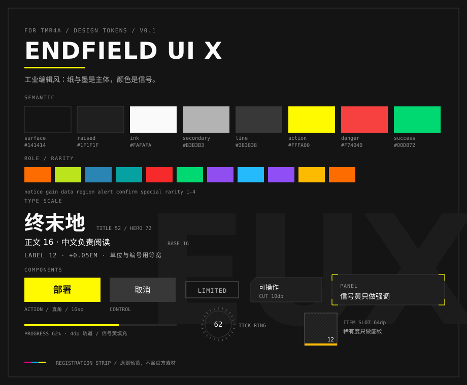

# Endfield UI X（EUX）v0.1

ForTMR4A 的 Android-First Endfield 风格 UI 令牌与资源。规范正文见
[`docs/ui/ENDFIELD-UI-X.md`](../docs/ui/ENDFIELD-UI-X.md)。

> 非官方项目，不含任何官方素材。令牌取值适配自 MIT 许可的
> [icaruszezen/endfield-ui](https://github.com/icaruszezen/endfield-ui)，
> 来源与边界见 [NOTICE.md](NOTICE.md)。



## 内容

| 路径 | 内容 |
|---|---|
| `tokens/endfield-ui-x.tokens.json` | 唯一令牌源（亮/暗语义色、角色色、字阶、间距、圆角、切角、动效） |
| `android/res/values/colors.xml` | 亮色颜色资源（`eux_*`） |
| `android/res/values-night/colors.xml` | 暗色覆盖 |
| `android/res/values/dimens.xml` | 间距/字阶/圆角/切角/触控尺寸 |
| `android/res/values/themes.xml` | `Theme.EUX`、`Theme.EUX.Overlay` |
| `android/res/values-night/themes.xml` | 夜间模式主题 |
| `android/res/values/styles.xml` | `EUX.Text.*`、`EUX.Button.*`、`EUX.Panel`、`EUX.Tag` |
| `android/res/drawable/*.xml` | 直角按钮、面板、描边标签 |
| `preview.svg` / `preview.png` | 原创预览图 |

## Android 接入（v0.1 手工合并）

```bash
# 在 android/app/src/main/res 下合并（eux_ 前缀避免与现有资源冲突）
cp -r ui-kit/android/res/values/*       android/app/src/main/res/values/
cp -r ui-kit/android/res/values-night/* android/app/src/main/res/values-night/
cp -r ui-kit/android/res/drawable/*     android/app/src/main/res/drawable/
```

- 设置页：`AndroidManifest.xml` 里的 Activity 设 `android:theme="@style/Theme.EUX"`；
- 游戏内面板：用 `Theme.EUX.Overlay`（固定暗色、透明窗口），颜色仍从 `eux_*` 取；
- 切角、角括号、斜纹、刻度圆环需要自绘（v0.2 提供 `EuxPanelDrawable` / `EuxShapes`）；
- 字体不打包：系统 `sans-serif` + `monospace` 先落地，需要一致观感再自托管（注意许可）。

## 令牌同步规则

`tokens/endfield-ui-x.tokens.json` 是**唯一真源**。v0.1 的 XML 为手工同步；
v0.2 加入 `scripts/gen_eux_res.py`（或 Rust CLI）从 JSON 生成 XML，避免两边漂移。

## 状态

- [x] v0.1 令牌 + Android 资源 + 规范文档 + 预览
- [ ] v0.2 View 封装（`EuxPanelDrawable`、`EuxButton`、`EuxTickRing`）
- [ ] v0.3 设置页 / 游戏内面板按规范重构
